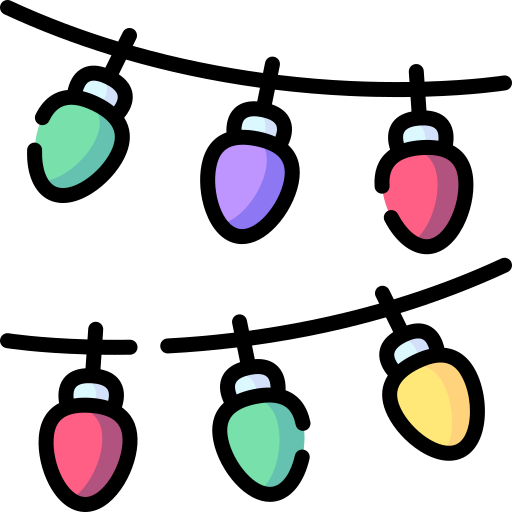

## Hello , I'm Sandra Golden 

I'm a software engineer  building stuff at Salesforce Commerce Cloud &nbsp;...

but I also like:<br/><br/>
swimming <br/>
soccer  (former collegiate player at )<br/>
bird watching <br/>
lattes <br/>
incandescent light <br/>
fish tacos <br/>
music <br/>
movies <br/>
laughing <br/>
silver <br/>
hiking <br/>
the number 
<br/><br/>
 <a href="https://www.linkedin.com/in/sandragolden/">in/sandragolden</a>
<br/><br/>
<!--START_SECTION:waka-->


**🐱 My GitHub Data** 

> 📦 8.4 MB Used in GitHub's Storage 
 > 
> 🏆 614 Contributions in the Year 2026
 > 
> 🚫 Not Opted to Hire
 > 
> 📜 46 Public Repositories 
 > 
> 🔑 230 Private Repositories 
 > 
**I'm an Early 🐤** 

```text
🌞 Morning                1148 commits        ██████░░░░░░░░░░░░░░░░░░░   22.66 % 
🌆 Daytime                2730 commits        █████████████░░░░░░░░░░░░   53.88 % 
🌃 Evening                988 commits         █████░░░░░░░░░░░░░░░░░░░░   19.50 % 
🌙 Night                  201 commits         █░░░░░░░░░░░░░░░░░░░░░░░░   03.97 % 
```
📅 **I'm Most Productive on Wednesday** 

```text
Monday                   1065 commits        █████░░░░░░░░░░░░░░░░░░░░   21.02 % 
Tuesday                  839 commits         ████░░░░░░░░░░░░░░░░░░░░░   16.56 % 
Wednesday                1221 commits        ██████░░░░░░░░░░░░░░░░░░░   24.10 % 
Thursday                 854 commits         ████░░░░░░░░░░░░░░░░░░░░░   16.85 % 
Friday                   734 commits         ████░░░░░░░░░░░░░░░░░░░░░   14.49 % 
Saturday                 247 commits         █░░░░░░░░░░░░░░░░░░░░░░░░   04.87 % 
Sunday                   107 commits         █░░░░░░░░░░░░░░░░░░░░░░░░   02.11 % 
```


📊 **This Week I Spent My Time On** 

```text
🕑︎ Time Zone: America/Los_Angeles

💬 Programming Languages: 
Markdown                 6 hrs 11 mins       █████░░░░░░░░░░░░░░░░░░░░   21.78 % 
Apex                     2 hrs 57 mins       ███░░░░░░░░░░░░░░░░░░░░░░   10.39 % 
Other                    2 hrs 54 mins       ███░░░░░░░░░░░░░░░░░░░░░░   10.26 % 
JSON                     2 hrs 45 mins       ██░░░░░░░░░░░░░░░░░░░░░░░   09.69 % 
JavaScript               2 hrs 14 mins       ██░░░░░░░░░░░░░░░░░░░░░░░   07.90 % 

🔥 Editors: 
Claude Code              14 hrs 33 mins      █████████████░░░░░░░░░░░░   51.25 % 
WebStorm                 5 hrs 51 mins       █████░░░░░░░░░░░░░░░░░░░░   20.61 % 
VS Code                  5 hrs 12 mins       █████░░░░░░░░░░░░░░░░░░░░   18.34 % 
IntelliJ IDEA            2 hrs 9 mins        ██░░░░░░░░░░░░░░░░░░░░░░░   07.59 % 
DataGrip                 25 mins             ░░░░░░░░░░░░░░░░░░░░░░░░░   01.51 % 

💻 Operating System: 
Mac                      28 hrs 24 mins      █████████████████████████   100.00 % 
```

**I Mostly Code in JavaScript** 

```text
Apex                     29 repos            ███░░░░░░░░░░░░░░░░░░░░░░   12.24 % 
TypeScript               13 repos            █░░░░░░░░░░░░░░░░░░░░░░░░   05.49 % 
Python                   8 repos             █░░░░░░░░░░░░░░░░░░░░░░░░   03.38 % 
HTML                     6 repos             █░░░░░░░░░░░░░░░░░░░░░░░░   02.53 % 
Shell                    4 repos             ░░░░░░░░░░░░░░░░░░░░░░░░░   01.69 % 
```


 Last Updated on 11/25/2026 18:25:21 UTC
<!--END_SECTION:waka-->
