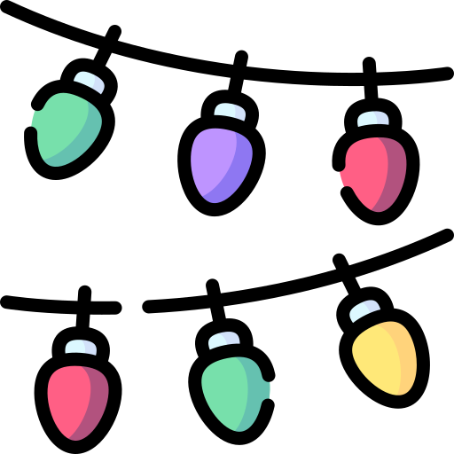

## Hello , I'm Sandra Golden 

I'm a software engineer  building stuff at Salesforce Commerce Cloud &nbsp;...

but I also like:<br/><br/>
swimming <br/>
soccer  (former collegiate player at )<br/>
bird watching <br/>
lattes <br/>
incandescent light <br/>
fish tacos <br/>
music <br/>
movies <br/>
laughing <br/>
silver <br/>
hiking <br/>
the number 
<br/><br/>
 <a href="https://www.linkedin.com/in/sandragolden/">in/sandragolden</a>
<br/><br/>
<!--START_SECTION:waka-->


**🐱 My GitHub Data** 

> 📦 8.4 MB Used in GitHub's Storage 
 > 
> 🏆 197 Contributions in the Year 2026
 > 
> 🚫 Not Opted to Hire
 > 
> 📜 46 Public Repositories 
 > 
> 🔑 227 Private Repositories 
 > 
**I'm an Early 🐤** 

```text
🌞 Morning                1070 commits        ██████░░░░░░░░░░░░░░░░░░░   22.96 % 
🌆 Daytime                2563 commits        ██████████████░░░░░░░░░░░   54.99 % 
🌃 Evening                851 commits         █████░░░░░░░░░░░░░░░░░░░░   18.26 % 
🌙 Night                  177 commits         █░░░░░░░░░░░░░░░░░░░░░░░░   03.80 % 
```
📅 **I'm Most Productive on Wednesday** 

```text
Monday                   997 commits         █████░░░░░░░░░░░░░░░░░░░░   21.39 % 
Tuesday                  800 commits         ████░░░░░░░░░░░░░░░░░░░░░   17.16 % 
Wednesday                1103 commits        ██████░░░░░░░░░░░░░░░░░░░   23.66 % 
Thursday                 765 commits         ████░░░░░░░░░░░░░░░░░░░░░   16.41 % 
Friday                   656 commits         ████░░░░░░░░░░░░░░░░░░░░░   14.07 % 
Saturday                 233 commits         █░░░░░░░░░░░░░░░░░░░░░░░░   05.00 % 
Sunday                   107 commits         █░░░░░░░░░░░░░░░░░░░░░░░░   02.30 % 
```


📊 **This Week I Spent My Time On** 

```text
🕑︎ Time Zone: America/Los_Angeles

💬 Programming Languages: 
SCSS                     5 hrs 36 mins       ██████░░░░░░░░░░░░░░░░░░░   25.65 % 
JavaScript               4 hrs 37 mins       █████░░░░░░░░░░░░░░░░░░░░   21.13 % 
Markdown                 3 hrs 47 mins       ████░░░░░░░░░░░░░░░░░░░░░   17.35 % 
Other                    1 hr 53 mins        ██░░░░░░░░░░░░░░░░░░░░░░░   08.65 % 
JSON                     1 hr 43 mins        ██░░░░░░░░░░░░░░░░░░░░░░░   07.91 % 

🔥 Editors: 
Claude Code              12 hrs 22 mins      ██████████████░░░░░░░░░░░   56.61 % 
WebStorm                 6 hrs 21 mins       ███████░░░░░░░░░░░░░░░░░░   29.07 % 
VS Code                  3 hrs 7 mins        ████░░░░░░░░░░░░░░░░░░░░░   14.32 % 

💻 Operating System: 
Mac                      21 hrs 52 mins      █████████████████████████   100.00 % 
```

**I Mostly Code in JavaScript** 

```text
JavaScript               143 repos           ███████████████░░░░░░░░░░   60.85 % 
Apex                     29 repos            ███░░░░░░░░░░░░░░░░░░░░░░   12.34 % 
TypeScript               12 repos            █░░░░░░░░░░░░░░░░░░░░░░░░   05.11 % 
Python                   8 repos             █░░░░░░░░░░░░░░░░░░░░░░░░   03.40 % 
Shell                    4 repos             ░░░░░░░░░░░░░░░░░░░░░░░░░   01.70 % 
```


 Last Updated on 11/02/2026 19:35:31 UTC
<!--END_SECTION:waka-->
